<p align="center">
  
</p>

<p align="center">
  
</p>

<p align="center">
  
  
  
  
</p>

## Overview

A compact React and Vite workspace used for workshop exercises and small experiments. It provides the standard fast-refresh development setup with ESLint.

## Highlights

- React 19 with Vite fast refresh
- ESLint configuration included
- Minimal, easy-to-extend structure

## Tech stack

<p align="center">
  
</p>

## Getting started

**Prerequisites:** Node.js 20+.

```bash
npm install
npm run dev
```

---

<p align="center">
  
</p>

<p align="center">
  Built by <a href="https://github.com/Skander-Bardaoui"><b>Skander Bardaoui</b></a> ·
  <a href="https://skander-bardaoui.netlify.app/">Portfolio</a> ·
  <a href="https://github.com/Skander-Bardaoui?tab=repositories">All repositories</a>
</p>
